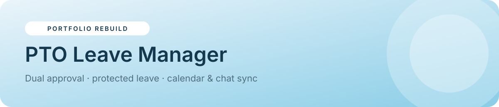

<p align="center"></p>

<p align="center">


<a href="https://sider.ai/agents/web-creator/share/695ea81100a621619985fdfb"></a>
</p>

<p align="center"><a href="https://naekitakadoportfolio.github.io/pto-leave-manager/"></a></p>

# PTO Leave Manager

A full leave-management web app: team calendar, leave requests with live policy checks, a two-step manager → HR approval workflow, balances, editable policies and an integrations activity log. It runs as a single-page app with hash routing and keeps demo data in your browser.

> **Portfolio rebuild.** A from-scratch recreation of *PTO Central*, a production system I designed and run. It uses **fictional people and data**, with no client names, code or branding.

## ✨ Features
- **Dashboard:** who's out today, upcoming leave, holidays, your balance and pending approvals at a glance
- **Interactive team calendar:** month navigation, team filter, color-coded leave types, pending vs approved, public holidays. Click any day for details or to start a request
- **Smart request form:** live working-day count (weekends and holidays excluded), balance check, overlap blocking, team-coverage warnings, and a privacy notice for protected leave
- **Dual approval:** Manager → HR, with coverage-risk and balance-after indicators, reject-with-reason and a full status timeline
- **Role-based access:** Employee, Manager, HR and Admin see different pages and data. Protected leave (medical, bereavement) shows only as "Time off" to teammates and managers
- **Policy admin:** HR/Admin can edit allowances, privacy flags, minimum coverage and the holiday calendar
- **Integrations log:** shows the calendar event, chat post, email and HRIS sync that fire in production
- **Light/dark theme**, responsive layout, and a one-click demo reset

## 🧭 Try it
1. Open the **[live demo](https://naekitakadoportfolio.github.io/pto-leave-manager/)** as **Ava Reyes** (Employee) and request leave
2. Switch **Signed in as** to **Marco Diaz** (Manager) → *Approvals* → approve
3. Switch to **Hana Sy** (HR) → approve → watch the calendar and activity log update

## 🏗 Production architecture
| Layer | Production | This demo |
|---|---|---|
| UI | Apps Script HTML Service web app | Static SPA (`index.html`) |
| Data | Google Sheets (requests, balances, policy) | `localStorage` |
| Auth & roles | Google account + role table | "Signed in as" switcher |
| Integrations | Google Calendar, Gmail, Slack webhooks, project tool, HRIS | Simulated activity log |
| Jobs | Time-driven triggers, cleanup orchestrator | n/a |

## 📁 Project structure
```
pto-leave-manager/
├── index.html        # app: views, router, state, styles
├── assets/banner.svg # README banner
├── README.md
└── LICENSE
```

## 🚀 Run locally
No build step needed. Open `index.html` in a browser, or serve it:
```bash
python3 -m http.server 8000   # then visit http://localhost:8000
```

## 🧩 Key implementation notes
- `wdays()` counts working days, skipping weekends and configured holidays
- `coverage()` computes the lowest number of people in across the requested range per team
- `label()` masks protected leave types based on the viewer's role
- State is a single object persisted to `localStorage`; *Reset demo data* re-seeds it

## 🗺 Roadmap
- Half-day requests and carry-over rules
- iCal export of the team calendar
- Accrual schedules per employment type

---
<p align="center"><sub>Built by <b>Nae Kitakado</b>, AI Automation Consultant · <a href="https://www.linkedin.com/in/nae-k-203194265">LinkedIn</a> · <a href="https://sider.ai/agents/web-creator/share/695ea81100a621619985fdfb">Portfolio</a> · open to retainer &amp; part-time consulting</sub></p>
